# PicoCTF Medium 2021
## 1. Weird File
Link bài: https://learn.cylabacademy.org/library/101?page=4&difficulty=2&category=4

Cách em làm:
* Em thấy file khá lạ nên vào coi hint trước thấy link youtube vô coi thử
* Video giảng về kiến thức Macro: Files nhúng bên trong file `.docm` và `.xlsm`
* Trong video có nói là sửa thành file `.docm` thành file `.zip` 
* Sau đó em binwalk file đó ra
```bash
shirou@Shirou09:~/Downloads$ tree _weird.zip.extracted/
_weird.zip.extracted/
├── 0.zip
├── [Content_Types].xml
├── customXml
│   ├── item1.xml
│   ├── itemProps1.xml
│   └── _rels
│       └── item1.xml.rels
├── docProps
│   ├── app.xml
│   └── core.xml
├── _rels
└── word
    ├── document.xml
    ├── fontTable.xml
    ├── _rels
    │   ├── document.xml.rels
    │   └── vbaProject.bin.rels
    ├── settings.xml
    ├── styles.xml
    ├── theme
    │   └── theme1.xml
    ├── vbaData.xml
    ├── vbaProject.bin
    └── webSettings.xml
```
* Em vào xem thấy có **vbaProject.bin** khá đặc biệt nên em vào đọc thử thì thấy có dòng 
```bash
Ret_Val = Shell("python -c 'print(\"YWNhZGVteXttNGNyMHNfcl9kNG5nM3IwdXN9\")'" & " " & Args, vbNormalFocus)
```
* Em thử dịch mã thì ra kết quả

Answer: **academy{m4cr0s_r_d4ng3r0us}**

## 2. Trivial Flag Transfer Protocol
Link bài: https://learn.cylabacademy.org/library/103?page=4&difficulty=2&category=4

Cách em giải:
* Lúc em tải file về thấy file này hơi nặng
* Lúc em xem Follow Stream của TFTP ( Trivial File Transfer Protocol: như TFP truyền tải gọn nhẹ hơn nhưng không đảm bảo an toàn) thì thấy có để tên mấy file ảnh bmp nên em download về 
```bash
shirou@Shirou09:~/Downloads/tftp$ ls
instructions.txt  picture1.bmp  picture2.bmp  picture3.bmp  plan  program.deb
```
* Em vào đọc instructions.txt trước nhưng nó là mã gì đấy em lên cyberchef nhưng nó không tự động dịch được nên em lên AI thử xem nó dịch được không
* AI dịch được là `TFTP DOESNT ENCRYPT OUR TRAFFIC SO WE MUST DISGUISE OUR FLAG TRANSFER. FIGUREOUT AWAY TO HIDE THE FLAG AND I WILL CHECK BACK FOR THE PLAN` và mã dịch là `ROT13`
* Sau đó em check cái plan thì cũng là mã và dùng ROT13 ra là `I USED THE PROGRAMAND HIDIT WITH - DUEDILIGENCE .CHECK OUT THE PHOTOS`
* Em binwalk program.deb thì ra là tool steghide
* Em dùng steghide với password là DUEDILIGENCE
```bash
shirou@Shirou09:~/Downloads/tftp$ steghide info picture1.bmp
"picture1.bmp":
  format: Windows 3.x bitmap
  capacity: 33.5 KB
Try to get information about embedded data ? (y/n) y
Enter passphrase: 
steghide: could not extract any data with that passphrase!
shirou@Shirou09:~/Downloads/tftp$ steghide info picture2.bmp
"picture2.bmp":
  format: Windows 3.x bitmap
  capacity: 1.5 MB
Try to get information about embedded data ? (y/n) y
Enter passphrase: 
steghide: could not extract any data with that passphrase!
shirou@Shirou09:~/Downloads/tftp$ steghide info picture3.bmp
"picture3.bmp":
  format: Windows 3.x bitmap
  capacity: 59.6 KB
Try to get information about embedded data ? (y/n) y
Enter passphrase: 
  embedded file "flag.txt":
    size: 40.0 Byte
    encrypted: rijndael-128, cbc
    compressed: yes
shirou@Shirou09:~/Downloads/tftp$ steghide extract -sf picture3.bmp
Enter passphrase: 
wrote extracted data to "flag.txt".
shirou@Shirou09:~/Downloads/tftp$ cat flag.txt 
academy{h1dd3n_1n_pLa1n_51GHT_18375919}
```
Answer: **academy{h1dd3n_1n_pLa1n_51GHT_18375919}**

## 3. Wireshark twoo twooo two twoo...
Link bài: https://learn.cylabacademy.org/library/110?page=4&difficulty=2&category=4

Cách em làm:
* Như thường lệ em vào Protocol Hierarchy thì thấy TCP chiếm nhiều % nhất nên xem Follow
* Em lướt hết thì thấy toàn fake flag nhưng có 2 chỗ đáng để ý

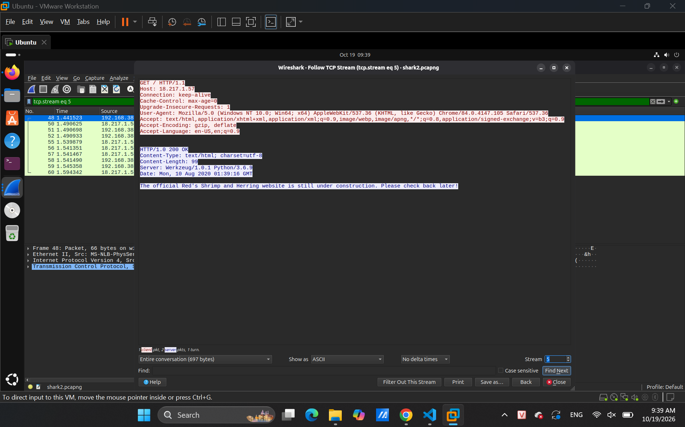
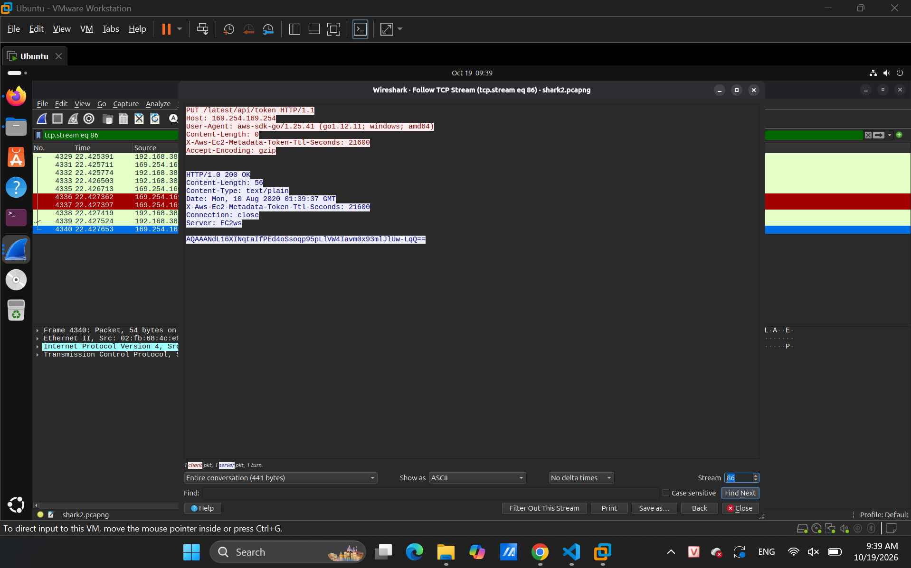

* Em thử dịch mã trước nhưng không được nên em thử cái cái còn lại

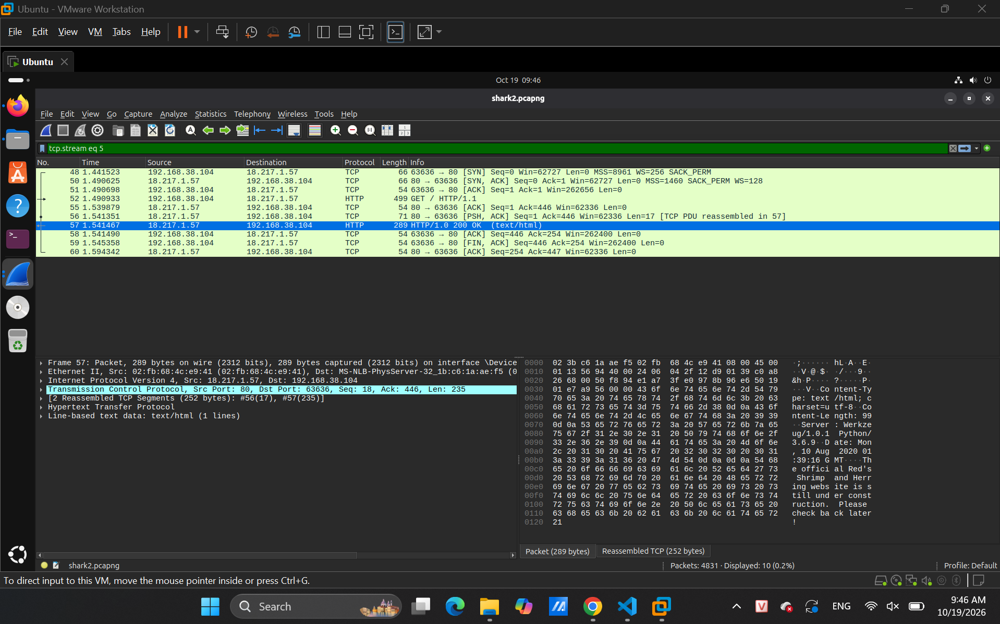

* Em dùng ip.src lướt 1 hồi thùi thấy

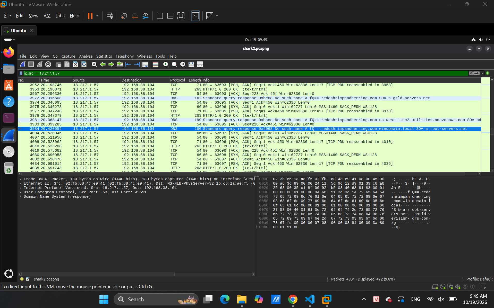

* Đuôi `fQ==` chắc chắn là flag và em thêm cái dns vào thì 

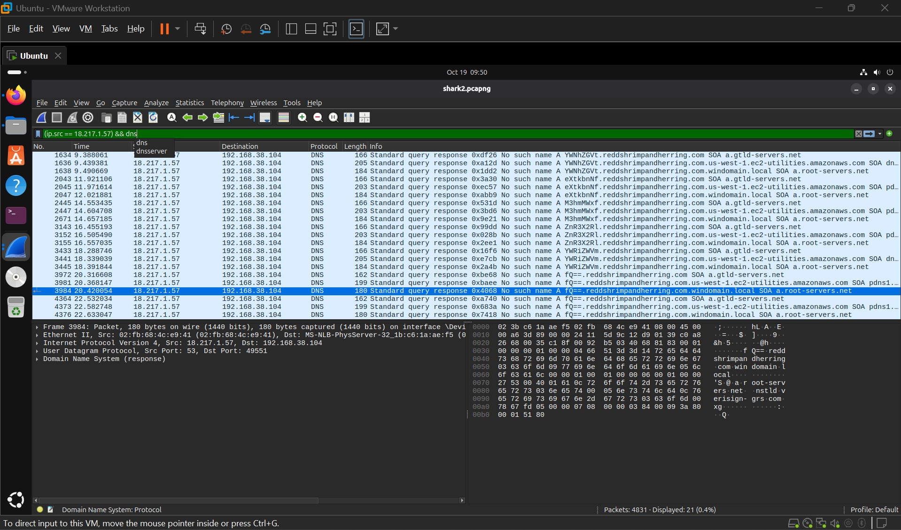

Answer: **academy{dns_3xf1l_ftw_deadbeef}**

## 4. tunn3l v1s10n 
Link bài: https://learn.cylabacademy.org/library/112?page=4&difficulty=2&category=4

Cách em làm:
* Khi tải về em thấy file hiện file img lỗi em nghĩ sẽ sài hexedit 
* Em thử kiểm tra thông tin trước thì thấy nó là file `.bmp`

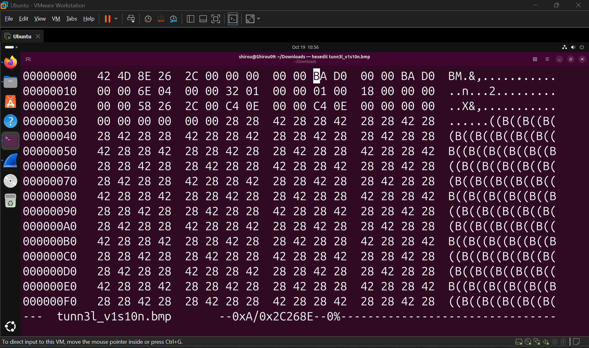

* Em dựa vào bản thì fix được ảnh như sau


* Tới đây em cũng không biết phải làm gì nữa nên xem write-up người khác
* Em nhận ra là do img chưa đủ chiều cao và cách tính như sau
```bash
Image Width                     : 1134
Image Height                    : 306
Planes                          : 1
Bit Depth                       : 24
Compression                     : None
Image Length                    : 2893400
Pixels Per Meter X              : 3780
Pixels Per Meter Y              : 3780
Num Colors                      : Use BitDepth
Num Important Colors            : All
Image Size                      : 1134x306
Megapixels                      : 0.347
```
* Dựa vào thông tin trên thì:
    * 24 bit sẽ tương ứng với 3 pixel (1 pixel 8 bit tương ứng với GRB)
    * Ta để tính height ta có công thức là height = length / (width*3)
    * Thay công thức trên ta được height = 850

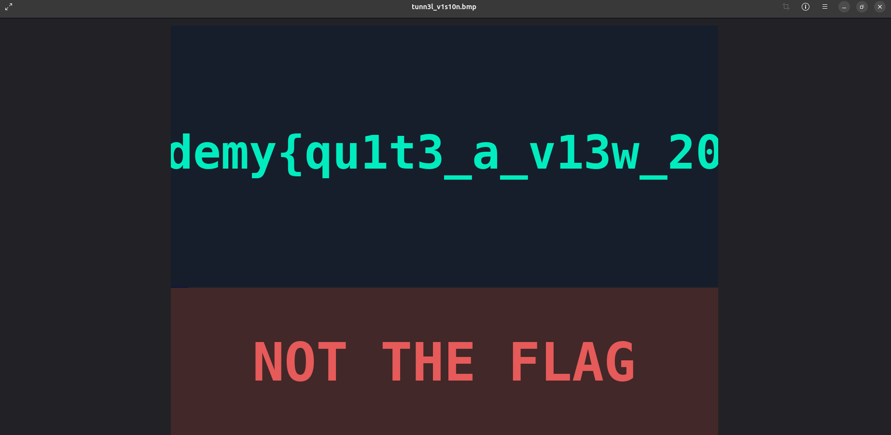

* Tới đây em cố tìm cách tăng width lên nhưng không được nó bị bể và lên xem write-up người khác thì ngta cũng chỉ tới 850 là hết rồi

Answer: **academy{qu1t3_a_v13w_2020}**

## 5. Disk, disk, sleuth!
Link bài: https://learn.cylabacademy.org/library/113?page=4&difficulty=2&category=4

Cách em làm:
* Đọc kĩ đề thì thấy chỉ cần tìm kiếm từ khóa của flag là ra

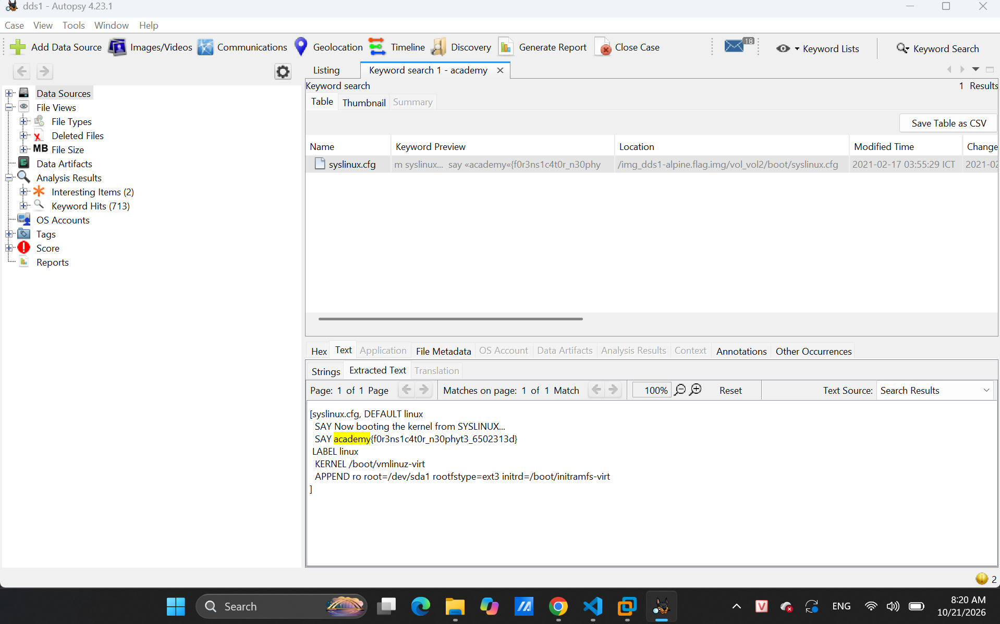

Answer: **academy{f0r3ns1c4t0r_n30phyt3_6502313d}**

## 6. Wireshark doo dooo do doo...
Link bài: https://learn.cylabacademy.org/library/115?page=4&difficulty=2&category=4

Cách em làm: 
* Em dùng Protocol Hierarchy thì thấy TCP chiếm nhiều nhất và Follow Stream thì thấy

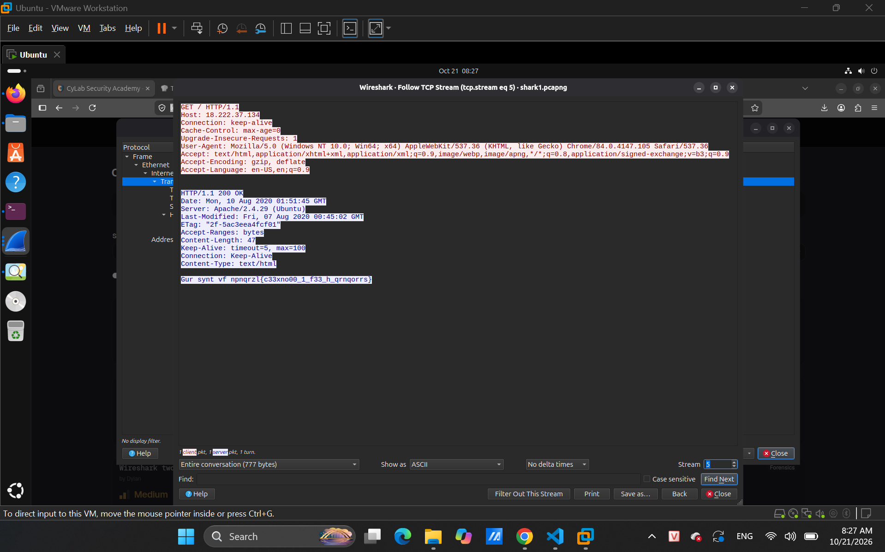

* Em so với bảng ACII thì thấy dùng mã ROT13 để dịch

Answer: **academy{p33kab00_1_s33_u_deadbeef}**

## 7. Matryoshka doll
Link bài: https://learn.cylabacademy.org/library/129?page=4&difficulty=2&category=4

Cách em làm: 
* Đề cho ta biết được món đề chơi này khi mở ra thì bên trong đó sẽ là 1 con y hệt nhưng nhỏ hơn cái trước và con cuối cùng nó sẽ chứa gì đó
* Em sài `binwalk -Me` thì ra
```bash
shirou@Shirou09:~/Downloads$ tree _dolls.jpg.extracted/
_dolls.jpg.extracted/
├── 4286C.zip
└── base_images
    ├── 2_c.jpg
    └── _2_c.jpg.extracted
        ├── 2DD3B.zip
        └── base_images
            ├── 3_c.jpg
            └── _3_c.jpg.extracted
                ├── 1E2D6.zip
                └── base_images
                    ├── 4_c.jpg
                    └── _4_c.jpg.extracted
                        ├── 136DA.zip
                        └── flag.txt

7 directories, 8 files
```
Answer: **academy{ZNTyvSDXRNO1d0xCkBRMhAoiafpCTvgW}**

## 8. MacroHard WeakEdge
Link bài: https://learn.cylabacademy.org/library/130?page=4&difficulty=2&category=4

Cách em làm: 
* Em thấy nếu muốn giấu file mấy phần mền Microsoft thì nó thuộc dạng Marco
* Em đổi file `.pptm` thành `.zip` và binwalk ra thì thấy
```bash
│   ├── slideMasters
│   │   ├── hidden
│   │   ├── _rels
│   │   │   └── slideMaster1.xml.rels
│   │   └── slideMaster1.xml
```
* Vào đọc file hidden thì ra đoạn mã sau
`ZmxhZzogYWNhZGVteXtEMWRfdV9rbjB3X3BwdHNfcl96MXA1fQ` lên cyberchef cho nó tự dịch thì ra flag

Answer: **academy{D1d_u_kn0w_ppts_r_z1p5}**

## 9. Disk, disk, sleuth! II
Link bài: https://learn.cylabacademy.org/library/137?page=4&difficulty=2&category=4

Cách em làm: 
* Đề cho biết luôn là flag ở trong file down-at-the-bottom.txt nên em search ra thì có luôn

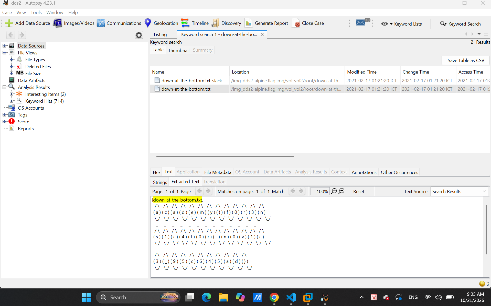

Answer: **academy{f0r3ns1c4t0r_n0v1c3_95c645ad}**

## 10. Milkslap
Link bài: https://learn.cylabacademy.org/library/139?page=3&difficulty=2&category=4

Cách em làm:
* Bài đưa em vào 1 trang web em nghĩ flag nó sẽ nằm trong cái bức ảnh động nên em tải về coi trước
* Em sài zsteg thì ra flag

Answer: **academy{imag3_m4n1pul4t10n_sl4p5}**

## 11. advanced-potion-making
Link bài: https://learn.cylabacademy.org/library/205?page=3&difficulty=2&category=4

Cách em giải:
* Em dùng exiftool thì thấy nó để file bị lỗi nên em dùng hexedit để sửa và nó thuộc file png

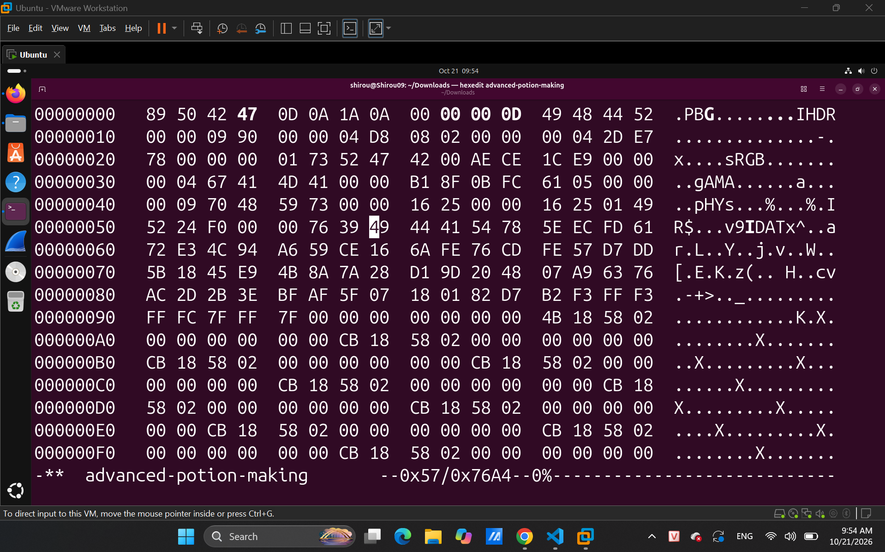
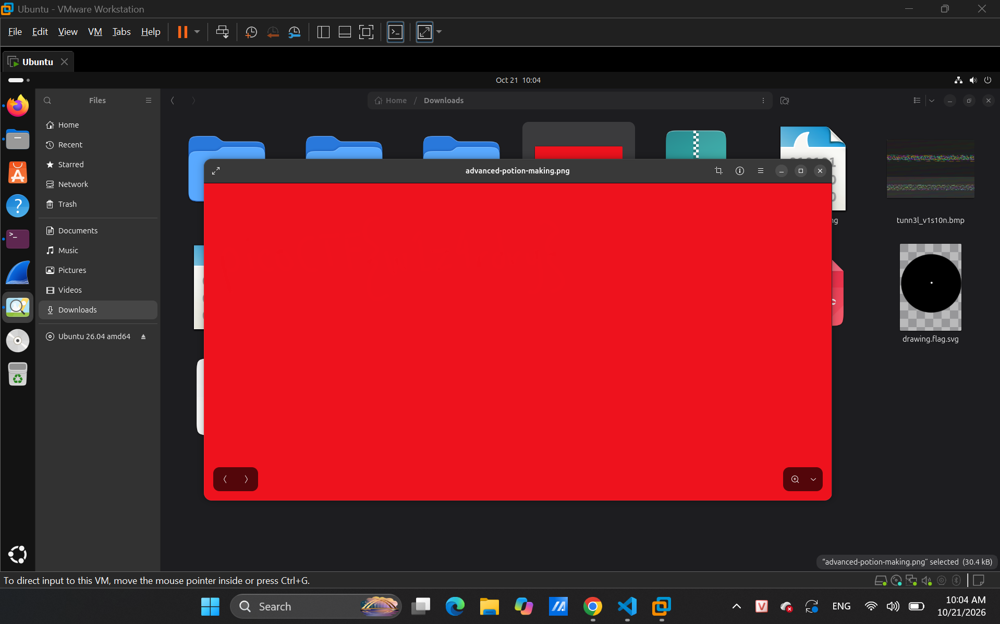

* Sau khi fix thì thấy toàn màu đỏ em nghĩ là chắc chữ flag cũng hòa màu đó rồi 
* Em search thử tool để giải file đó thì ra stegsolve

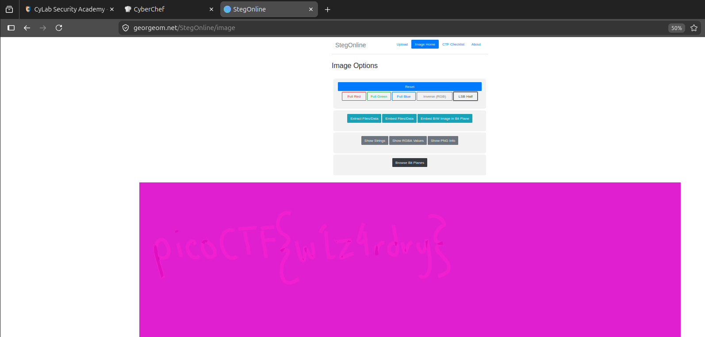

Answer: **picoCTF{w1z4rdry}**

## 12. WPA-ing Out
Link bài: https://learn.cylabacademy.org/library/237?page=3&difficulty=2&category=4

Cách em giải: 
* Em vào Protocol Hierarchy thì chỉ có IEEE 802.11
* Theo như em tìm hiểu thì nói đơn giản IEEE trên là Wifi và bảo mật khá kém nên hacker có thể hack vào crack password như đề bài đã cho
* Em không biết làm gì tiếp thôi nên coi hint thì thấy có nhắc về tool Aircrack-ng (dùng để crack password)
* Cách dùng để bẻ khóa: `aircrack-ng -w /path/wordlist.txt  file.pcap`
* Trước khi sài thì ta cần tải rockyou wordlist (list chứa password, chuỗi kí tự để bảo mật) trước 
```bash
shirou@Shirou09:~/Downloads$ aircrack-ng -w rockyou.txt wpa-ing_out.pcap 
Reading packets, please wait...
Opening wpa-ing_out.pcap
Resetting EAPOL Handshake decoder state.
Resetting EAPOL Handshake decoder state.
Read 23523 packets.

   #  BSSID              ESSID                     Encryption

   1  00:5F:67:4F:6A:1A  Gone_Surfing              WPA (1 handshake)

Choosing first network as target.

Reading packets, please wait...
Opening wpa-ing_out.pcap
Resetting EAPOL Handshake decoder state.
Resetting EAPOL Handshake decoder state.
Read 23523 packets.

1 potential targets


                               Aircrack-ng 1.7 

      [00:00:00] 1234/10303727 keys tested (8998.07 k/s) 

      Time left: 19 minutes, 4 seconds                           0.01%

                       Current passphrase: mickeymouse                
                          KEY FOUND! [ mickeymouse ]

      Master Key     : 61 64 B9 5E FC 6F 41 70 70 81 F6 40 80 9F AF B1 
                       4A 9E C5 C4 E1 67 B8 AB 58 E3 E8 8E E6 66 EB 11 

      Transient Key  : 90 63 ED C6 BB 8A 59 D1 A5 E8 B4 6F 2F 89 66 C2 
                       0B D4 FC 62 37 2F 54 3B 7B B4 43 9B 37 F4 57 40 
                       FD D1 91 86 7F FE 26 85 7B AC DD 2C 44 E6 06 18 
      EAPOL HMAC     : 65 2F 6C 0E 75 F0 49 27 6A AA 6A 06 A7 24 B9 A9
```
* Do đề chỉ kêu tìm password thôi nên nó cũng là flag luôn

Answer: **academy{mickeymouse}**
