# PicoCTF Medium 2022
## 1. Eavesdrop
Link bài: https://learn.cylabacademy.org/library/264?page=3&difficulty=2&category=4

Cách em làm: 
* Protocol Hierarchy > Stream thì em thấy

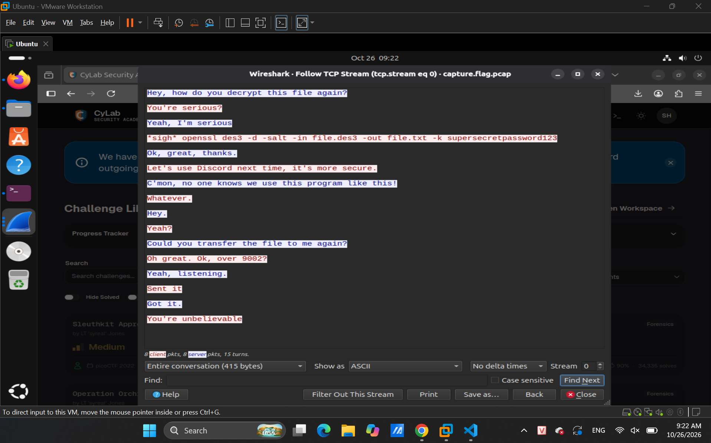
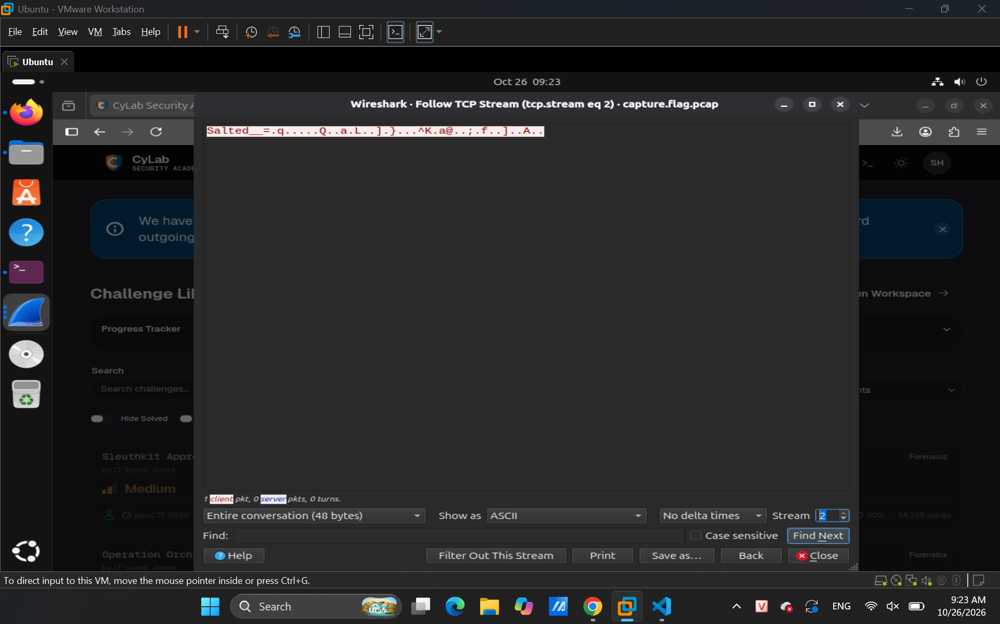

* Như cuộc hội thoại trên thì em nghĩ dùng code trên giải cái hình thứ 2 thì sẽ ra flag
* Nhưng trước khi tải thì `openssl` chỉ giải mã đoạn mã raw, hex, base64, ... nên phải chuyển qua dạng raw trước

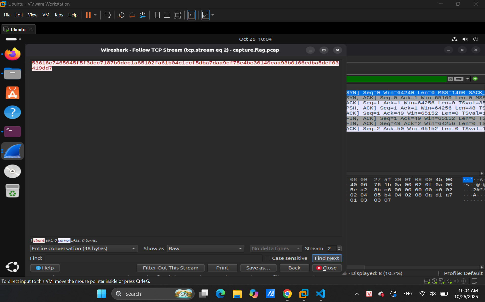

* Sau đó dùng code là ra

Answer: **academy{nc_73115_411_70df147f}**

## 2. Enhance!
Link bài: https://learn.cylabacademy.org/library/265?page=3&difficulty=2&category=4

Cách em giải:
* Em thấy đuôi file là `.svg` nên em search thử file đó là gì thì em biết được là file img này được code ra 
* Em dùng strings để đọc code thì thấy những dòng như sau:
```bash
id="tspan3748">a </tspan><tspan
         id="tspan3754">c </tspan><tspan
         id="tspan3756">a </tspan><tspan
         id="tspan3758">d </tspan><tspan
         id="tspan3760">e </tspan><tspan
         id="tspan3762">m </tspan><tspan
         id="tspan3764">y { 3 n h 4 n </tspan><tspan
         id="tspan3752">c 3 d _ 9 f 3 1 c 0 4 b }</tspan></text>
```

Answer: **academy{3nh4nc3d_9f31c04b}**

## 3. File types
Link bài: https://learn.cylabacademy.org/library/268?page=3&difficulty=2&category=4

Cách em làm:
* Em sài exiftool thì biết được file `.pdf` này thuộc loại shell archive nên em chuyển lại thành file `.zip`
* Giải nén 1 đống file thì ra flag
Answer: **academy{f1len@m3_m@n1pul@t10n_f0r_0b2cur17y_35957b68}**

## 4. Lookey here
Link bài: https://learn.cylabacademy.org/library/279?page=3&difficulty=2&category=4

Cách em làm: 
* Em thấy file ghi nhiều chữ nên em thử grep thì ra flag luôn
```bash
shirou@Shirou09:~/Downloads$ cat anthem.flag.txt | grep 'academy'
      we think that the men of academy{gr3p_15_@w3s0m3_375ef577}
```

Answer: **academy{gr3p_15_@w3s0m3_375ef577}**

## 5. Operation Oni
Link bài: https://learn.cylabacademy.org/library/284?page=3&difficulty=2&category=4

Cách em làm:
* Em vào autospy và phần root thì thấy

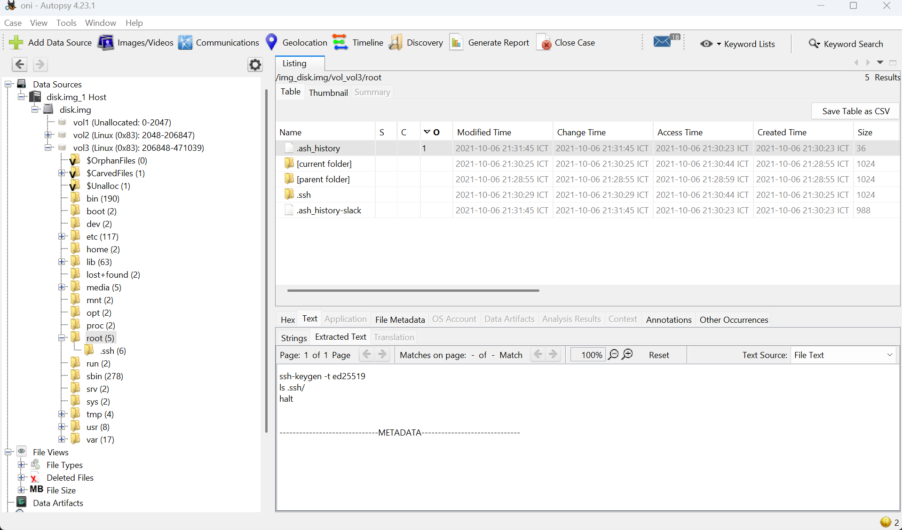
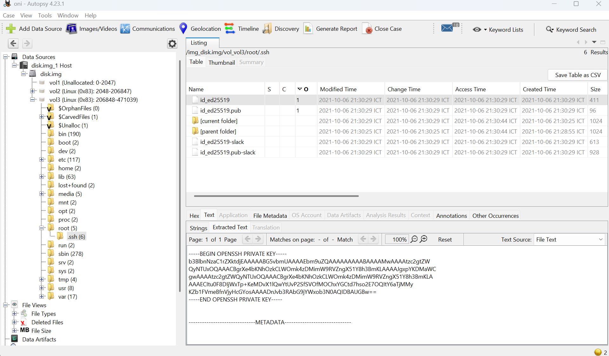

* Sau khi tải file vào áp lệnh thì nó lại hiện `WARNING: UNPROTECTED PRIVATE KEY FILE!`
* Sau khi em search thử thì chỉ cần `chmod` đổi quyền như sau

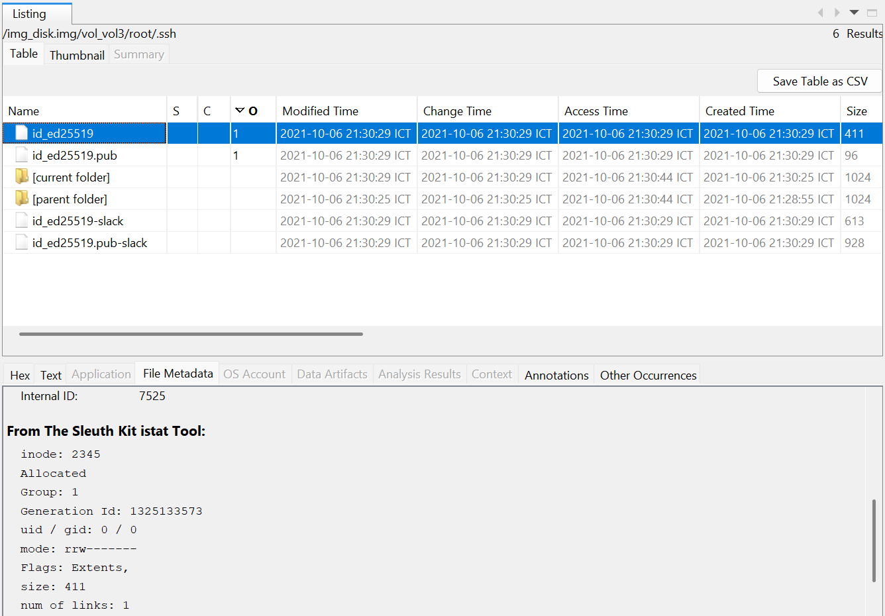

* Sau khi đổi thì đã kết nối thành công và tìm được flag

Answer: **academy{k3y_5l3u7h_127b8b44}**

## 6. Operation Orchid 
Link bài: https://learn.cylabacademy.org/library/285?page=3&difficulty=2&category=4

Cách em làm: 
* Em vào autospy phần root thì thấy

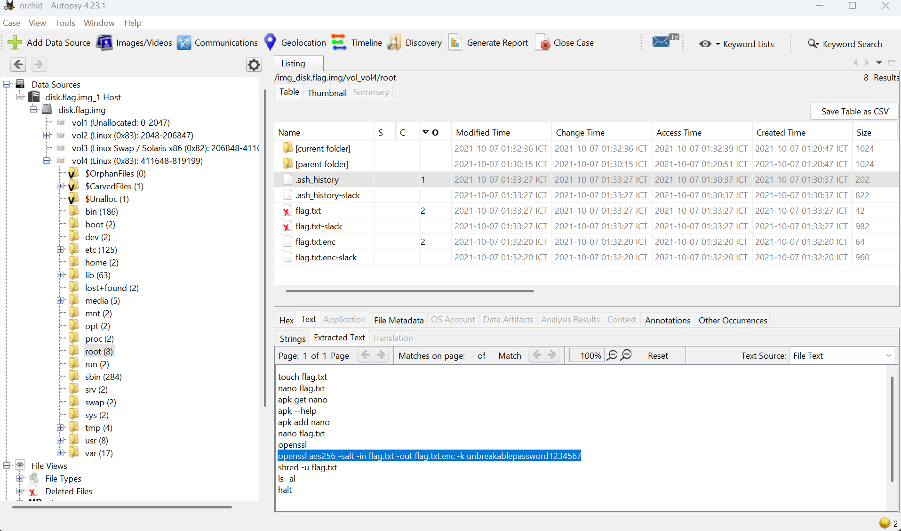

* Lệnh trên là encrypto => muốn decrypto thì sài lệnh sau:
```bash
shirou@Shirou09:~/Downloads$ openssl aes256 -d -salt -in flag.txt.enc -out flag.txt -k unbreakablepassword1234567
*** WARNING : deprecated key derivation used.
Using -iter or -pbkdf2 would be better.
bad decrypt
40874FDC2D780000:error:1C800064:Provider routines:ossl_cipher_unpadblock:bad decrypt:../providers/implementations/ciphers/ciphercommon_block.c:107:
shirou@Shirou09:~/Downloads$ cat flag.txt
academy{h4un71ng_p457_0cf3a06d}
```

Answer: **academy{h4un71ng_p457_0cf3a06d}**

## 7. Packets Primer
Link bài: https://learn.cylabacademy.org/library/286?page=3&difficulty=2&category=4\

Cách em làm: 
* Thấy ít packet quá em vô sài follow stream thì ra luôn flag

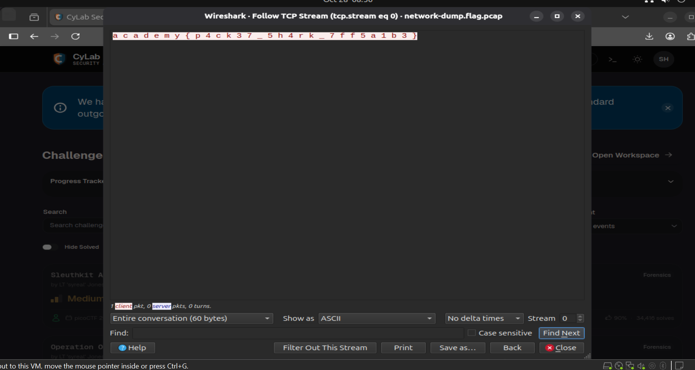

Answer: **academy{p4ck37_5h4rk_7ff5a1b3}**

## 8. Redaction gone wrong
Link bài: https://learn.cylabacademy.org/library/290?page=3&difficulty=2&category=4

Cách em làm:
* Cách 1:
    * Lúc em di chuột xuống phần bôi đen thì chuột nó hiện kiểu quét chữ copy được và nó ra flag luôn
* Cách 2:
    * Em vô coi code web 

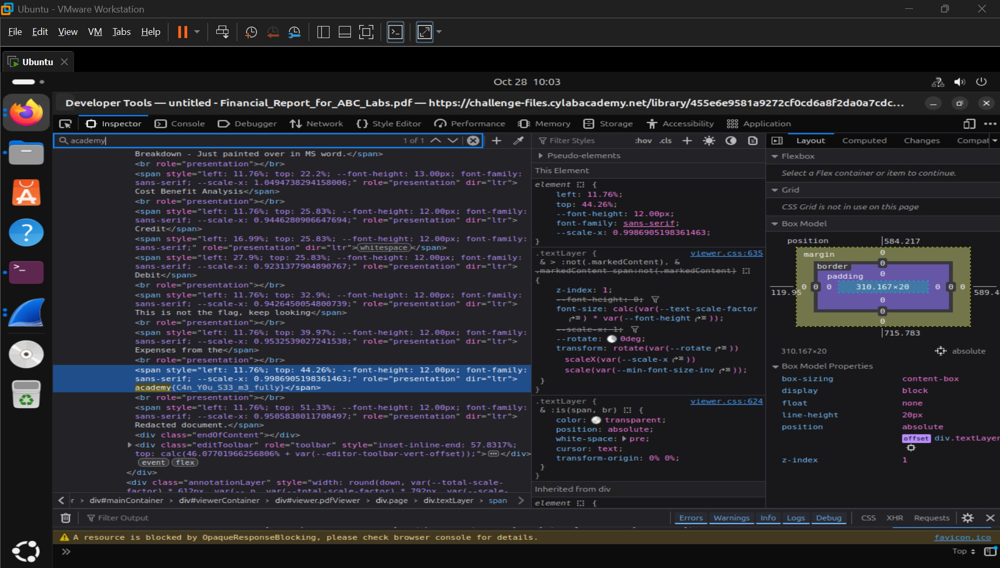

Answer: **academy{C4n_Y0u_S33_m3_fully}**

## 9. Sleuthkit Apprentice
Link bài: https://learn.cylabacademy.org/library/300?page=3&difficulty=2&category=4

Cách em làm:

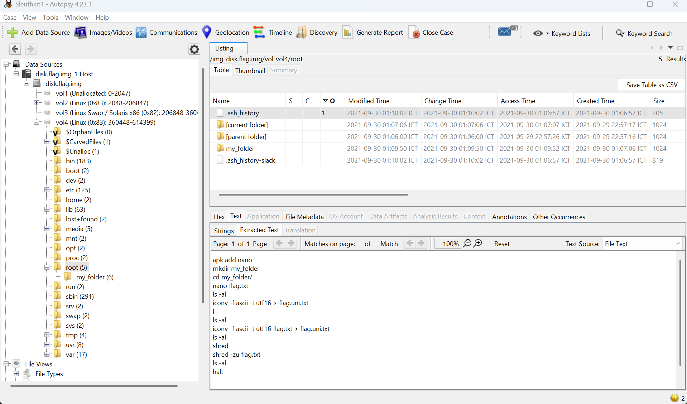

* Em search 2 lệnh và biết được
* `iconv`: chuyển đổi định dạng mã
* `shred`: ghi đè
* Như hình trên thì nó `iconv` flag.txt sang cho flag.uni.txt và `shred` flag.txt ghi đè và xóa dấu viết flag.txt => flag sẽ nằm trong flag.uni.txt

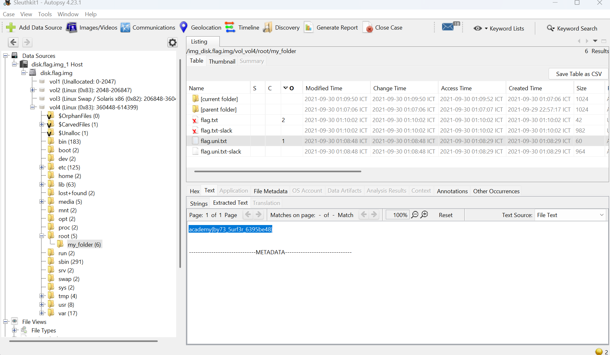


Answer: **academy{by73_5urf3r_6395be48}**

## 10. Sleuthkit Intro
Link bài: https://learn.cylabacademy.org/library/301?page=2&difficulty=2&category=4

Cách em làm:
* Đề yêu dùng lệnh `nc` để kết nối
```bash
shirou@Shirou09:~/Downloads$  nc chatelaine.cylabacademy.net 33615
What is the size of the Linux partition in the given disk image?
Length in sectors:
```
* Yêu cầu nhập length Linux ta vào autospy để coi

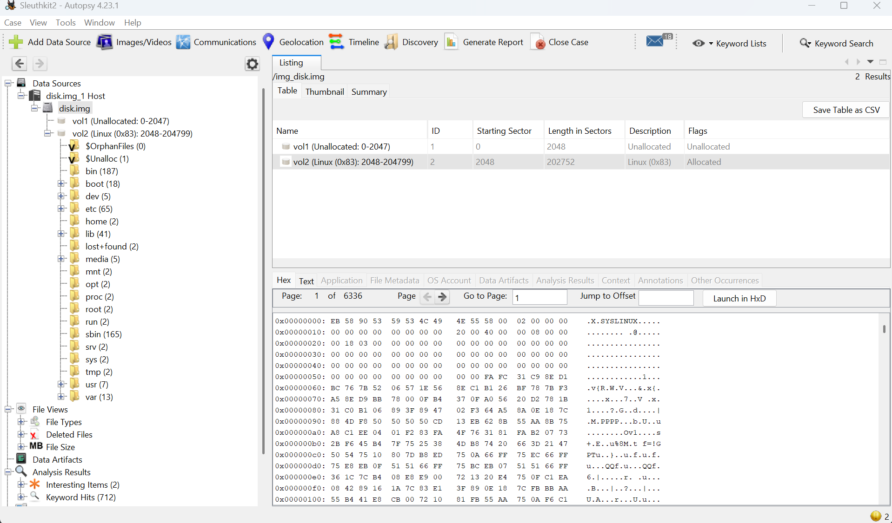

```bash
shirou@Shirou09:~/Downloads$  nc chatelaine.cylabacademy.net 33615
What is the size of the Linux partition in the given disk image?
Length in sectors: 202752 
202752
Great work!
academy{mm15_f7w!}
```

Answer: **academy{mm15_f7w!}**

## 11. St3g0
Link bài: https://learn.cylabacademy.org/library/305?page=2&difficulty=2&category=4

Cách em làm:
* Sài `zsteg` là ra
```bash
shirou@Shirou09:~/Downloads$ zsteg academy.flag.png 
b1,r,lsb,xy         .. text: "~__B?+c_G@"
b1,rgb,lsb,xy       .. text: "academy{7h3r3_15_n0_5p00n_6c8e74e0}"
```

Answer: **academy{7h3r3_15_n0_5p00n_6c8e74e0}**

## 12. Torrent Analyze\
Link bài: https://learn.cylabacademy.org/library/311?page=2&difficulty=2&category=4

Cách em giải:
* Khi em vừa thấy tên bài em search tìm hiểu thử những kiến thức sau:
    * Torrent: 1 file chứa chi tiết dữ liệu nguồn nơi tìm thấy các file và thư mục phân tán trên Internet
    * Peers: Những người tham gia tải file bằng Torrent
    * Seeders: Những người tải xuống 100% và chia sẻ cho người khác
    * Leerchers: Những người tải xuống nhưng chưa tải hết 100%
    * BitTorrent: P2P (Peer-to-Peer) cho phép tải qua nhiều người mà không qua server
    * BT-DHT: thường có info-hash để tra cứu dữ liệu
    * BT-UTP: Dùng để vận chuyển packet xác định SEQ, ACK, ...
* Qua kiến thức trên thì em nghĩ flag nó sẽ nằm ở cái info hash
* Sau đó dùng wireshark để lọc cái BT-DHT
* Em lướt thấy nhiều info hash quá nhưng có 1 cái được lặp lại nhiều lần là **e2467cbf021192c241367b892230dc1e05c0580e**

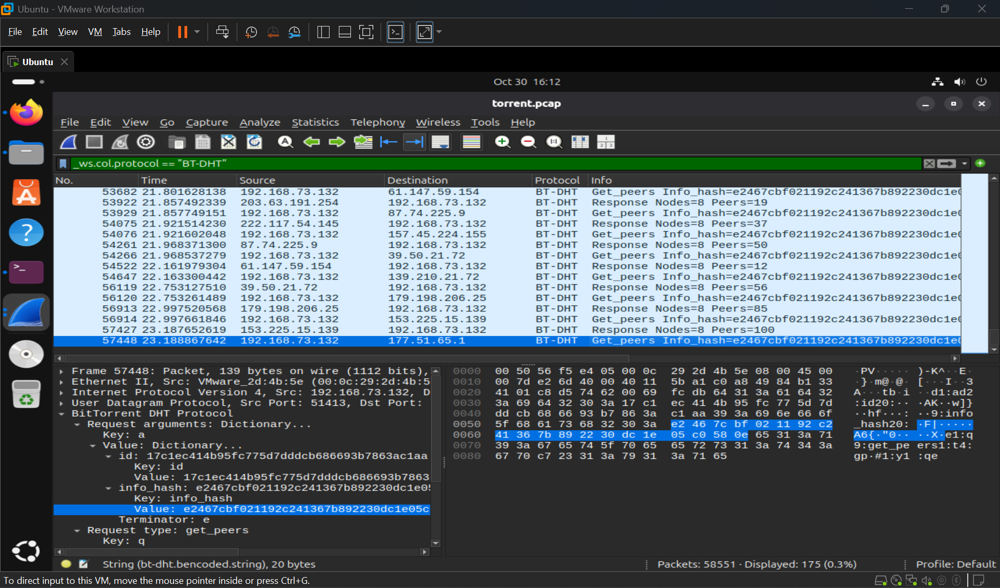

* Em dùng hint coi thử có tool nào để tra cứu không và kết quả là không
* Em search thử trên mạng và ra được web này https://torrentanalytics.net/search_hash

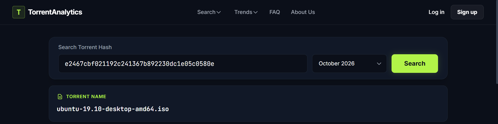

* Dựa vào hint thì ra được flag

Answer: **academy{ubuntu-19.10-desktop-amd64.iso}**