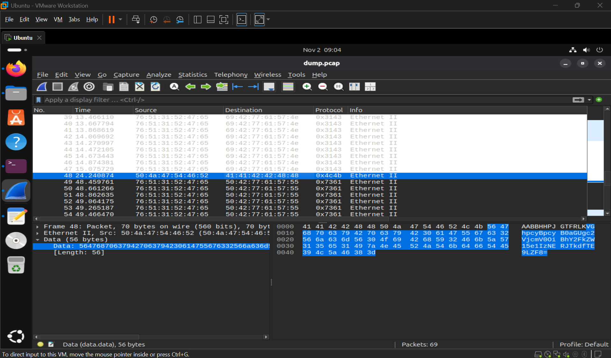
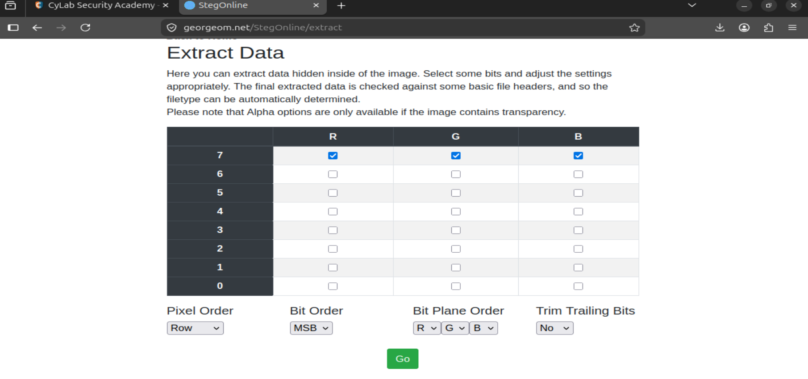
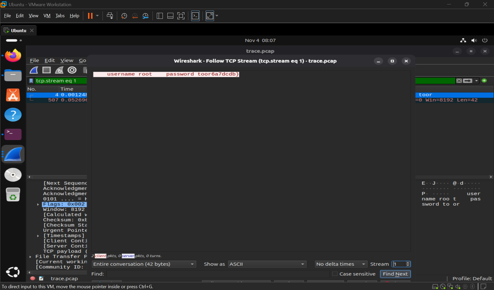
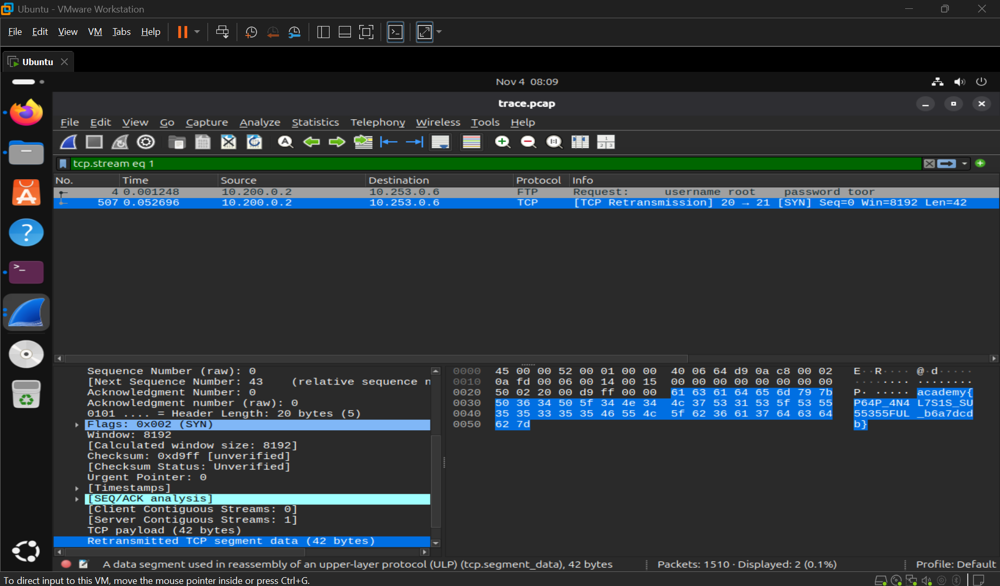

# PicoCTF Medium 2023
## 1. FindAndOpen
Link bài: https://learn.cylabacademy.org/library/348?page=2&difficulty=2&category=4

Cách em làm: 
* Em thấy có 1 file `pcap` và 1 file `zip` cần nhập password 
* Em lướt thử thì thấy có đoạn mã lạ



* Vô cyberchef giải thử thì nó giải ra **This is the secret: academy{R34DING_LOKd_**
* Em thử chép đoạn academy vào password thì extract ra flag

Answer: **academy{R34DING_LOKd_fil56_succ3ss_48035188}**

## 2. hideme
Link bài: https://learn.cylabacademy.org/library/350?page=2&difficulty=2&category=4

Cách em làm:
```bash
shirou@Shirou09:~/Downloads$ strings flag.png | grep 'academy'
academy{Hiddinng_An_imag3_within_@n_ima9e_ba7f84d1}
```

Answer: **academy{Hiddinng_An_imag3_within_@n_ima9e_ba7f84d1}**

## 3. MSB
Link bài: https://learn.cylabacademy.org/library/359?page=2&difficulty=2&category=4

Cách em làm: 
* Em thấy tên bài với đề lần lượt nhắc tới LSB và MSB
    * MSB (Most Significant Bit): Bit nằm bên đầu trái
    * LSB (Least Significant Bit): Bit nằm bên cuối phải
    ```bash
    Byte:  1 0 1 1 0 0 1 0
           ↑             ↑
          MSB           LSB
    ```
* Do đề bài đã nói check phần LSB rồi nên em sẽ check phần MSB
* Lên steg online rồi tải file về



```bash
shirou@Shirou09:~/Downloads$ strings Ninja-and-Prince-Genji-Ukiyoe-Utagawa-Kunisadaflag.dat | grep 'academy'
academy{15_y0ur_que57_qu1x071c_0r_h3r01c_80119e7f}
```

Answer: **academy{15_y0ur_que57_qu1x071c_0r_h3r01c_80119e7f}**

## 4. PcapPoisoning
Link bài: https://learn.cylabacademy.org/library/362?page=2&difficulty=2&category=4

Cách em làm:
* Protocol Hierarchy xem thì thấy tcp chiếm nhiều % nhất em vô stream thử thì thấy có mỗi này hiện khác với mấy cái còn lại



* Em vô xem stream đó có packets gì và thấy packet thứ 2 chứa flag




Answer: **academy{P64P_4N4L7S1S_SU55355FUL_b6a7dcdb}**