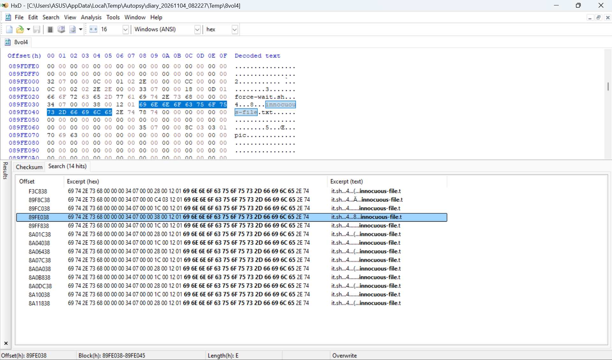
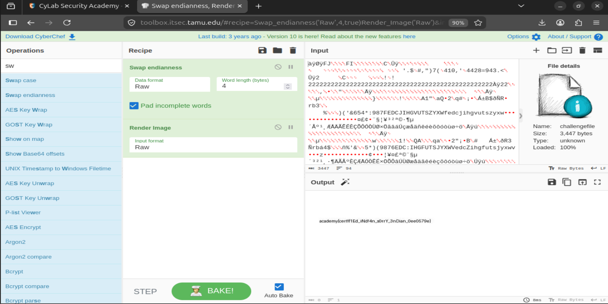
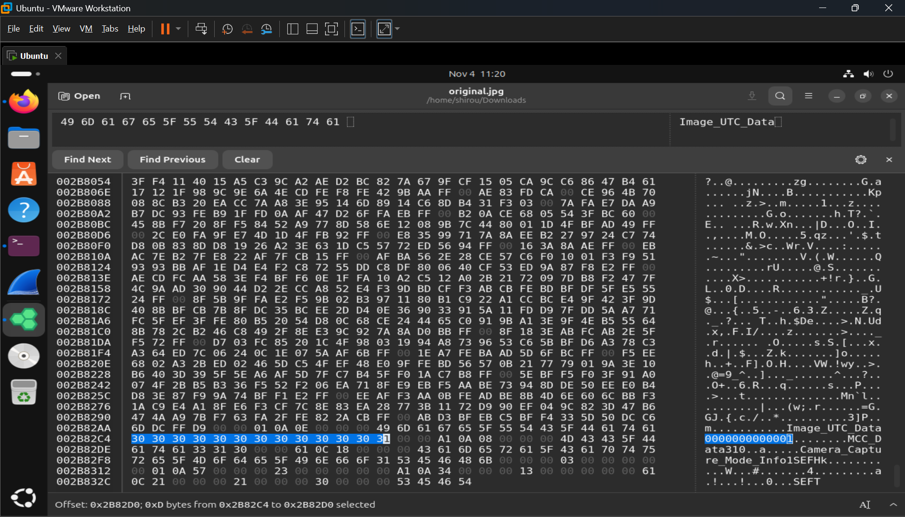

# PicoCTF Medium 2024

## 1. Dear Diary
Link bài: https://learn.cylabacademy.org/library/413?page=2&difficulty=2&category=4

Cách em làm:
* Em sài autospy vào root xem thì thấy có folder secret vào coi thử có file `.txt` không đọc được
* Em sài hint thử và thấy nó kêu dùng hexedit
* Em find thử `innocuous-file` thì ra 1 đống kết quả sau



Answer: **academy{1_533_n4m35_a1eed517}**

## 2. endianness-v2
Link bài: https://learn.cylabacademy.org/library/415?page=2&difficulty=2&category=4

Cách em làm:
* Em `exiftool` ra thì thấy
```bash
Warning                         : Processing JPEG-like data after unknown 1-byte header
```
* Lên tìm hiểu thử thì biết nó bị xáo trộn
* Em fix thử phần head nhưng không ra
* Em thử search tên bài `endianness` thì biết được nguyên file nó bị xáo trộn hết chứ không phải head không
* Search thử cách fix file trên cyberchef thì được



Answer: **academy{cert!f1Ed_iNd!4n_s0rrY_3nDian_0ee0579e}**

## 3. Mob psycho
Link bài: https://learn.cylabacademy.org/library/420?page=2&difficulty=2&category=4

Cách em làm:
* Em thấy file này extract được 
* Extract ra 1 đống file nên em dùng `find` thử có ra không nếu không thì mò và hên quá có
```bash
shirou@Shirou09:~/Downloads/_mobpsycho.apk.extracted$ find -iname 'flag*'
./res/color/flag.txt
```

Answer: **academy{ax8mC0RU6ve_NX85l4ax8mCl_054e3cc4}**

## 4. Blast from the past
Link bài: https://learn.cylabacademy.org/library/432?page=2&difficulty=2&category=4

Cách em giải:
* Em đọc đề thấy người ta bảo phải setup thời gian về quá khứ
```bash
shirou@Shirou09:~/Downloads$ nc xebec.cylabacademy.net 27785
MD5 of your picture:
06783ef2aa4460a3d267002a28ff12c6  test.out

Checking tag 1/7
Looking at IFD0: ModifyDate
Looking for '1970:01:01 00:00:00'
Found: 2023:11:20 15:46:23
Oops! That tag isn't right. Please try again.
shirou@Shirou09:~/Downloads$ exiftool -ModifyDate='1970:01:01 00:00:00' original.jpg 
    1 image files updated
shirou@Shirou09:~/Downloads$ nc -w 2 xebec.cylabacademy.net 25143 < original.jpg (Cập nhật cái mình mới thay đổi)
shirou@Shirou09:~/Downloads$ nc xebec.cylabacademy.net 27785
MD5 of your picture:
967339c2493951097d71a62197d764c3  test.out

Checking tag 1/7
Looking at IFD0: ModifyDate
Looking for '1970:01:01 00:00:00'
Found: 1970:01:01 00:00:00
Great job, you got that one!

Checking tag 2/7
Looking at ExifIFD: DateTimeOriginal
Looking for '1970:01:01 00:00:00'
Found: 2023:11:20 15:46:23
Oops! That tag isn't right. Please try again.
```
* Setup tới tới checking thì em không sửa được bằng exiftool nữa
* Lúc này em lên coi write-up người khác thì thấy họ giải bằng hex
* Giờ chuyển tới hex phần ACII find 1700513181 (2023-11-20 20:46:21 nhưng được đổi qua UNIX Timestamp)
* Sửa phần hex lại thành 1ms (1970:01:01 00:00:00.001+00:00)



*Answer: **academy{71m3_7r4v311ng_p1c7ur3_4d2cbfbd}**