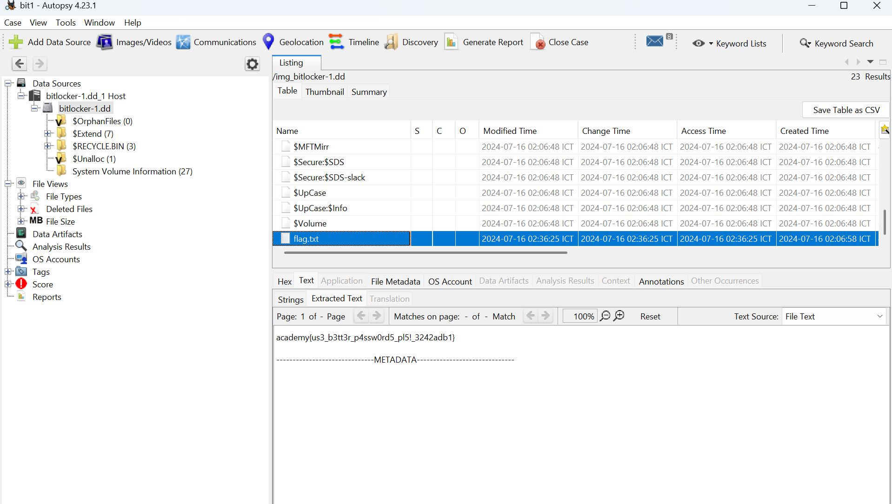
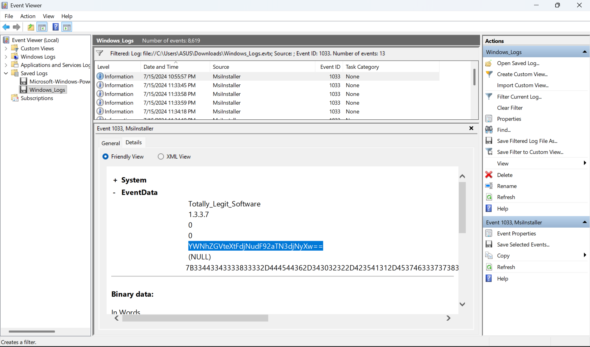
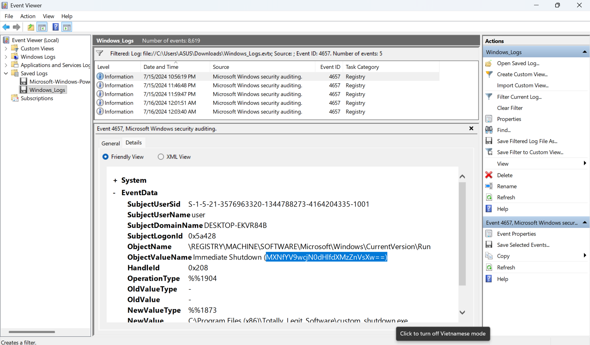
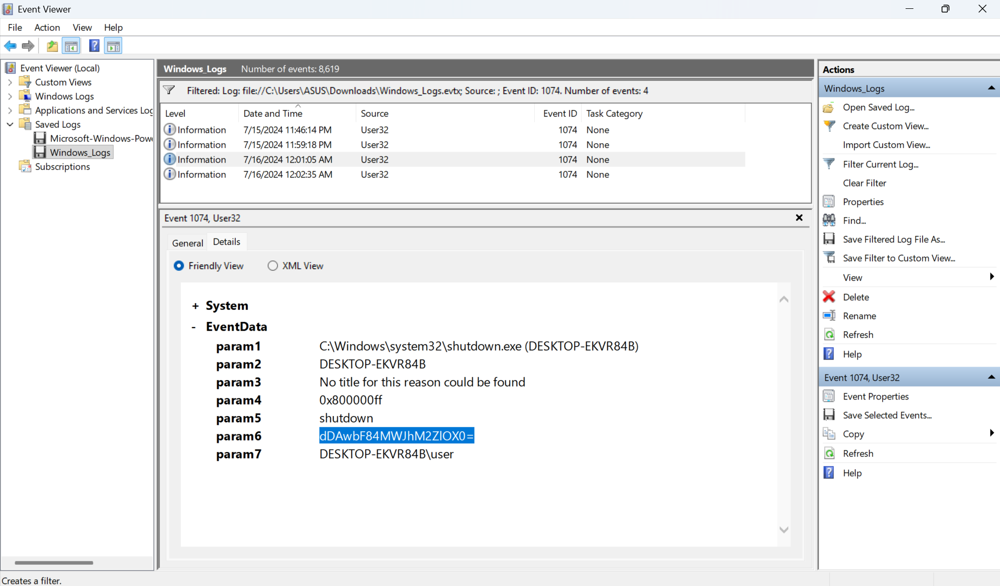
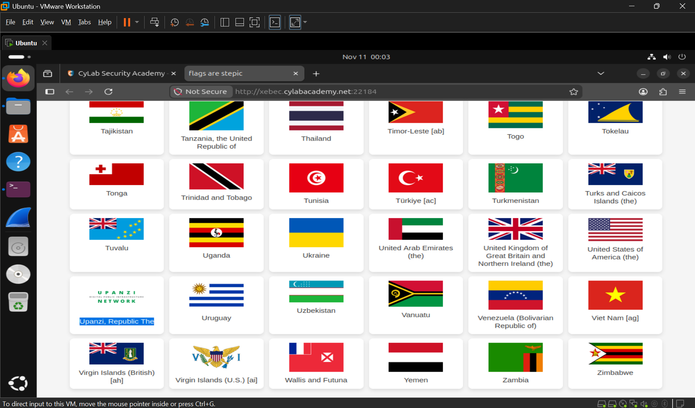

# PicoCTF Medium 2025

## 1. Bitlocker-1
Link bài: https://learn.cylabacademy.org/library/453?page=2&difficulty=2&category=4

Cách em làm:
* Khi vào autospy thì nó yêu cầu nhập password mới vào xem được 
* Em nhờ AI tìm tool và code chứ em search nó không đề xuất
```bash
python3 bitlocker2john.py bitlocker-1.dd > bit1.txt #Xuất hash chứa password 
[+] BitLocker signature found: -FVE-FS-
[+] Identified volume GUID: 4967D63B-2E29-4AD8-8399-F6A339E3D001 = BitLocker
[+] FVE metadata info found at offsets ['0x2195000', '0x2c1d000', '0x373a000']

Parsing FVE metadata header...
Metadata size: 834
Volume GUID: FCC70221-16CC-47AB-8E8B-D70A33C22A2F
Encryption method: 0x8002

Parsing FVE block...

Parsing FVE metadata entry...
Entry size: 82
Entry type: 0x7 = Computer description
Value type: 0x2 = UTF-16 string

Parsing description...
Info: DESKTOP-EKVR84B New Volume 7/15/2024
...

hashcat -m 22100 bit1.txt rockyou.txt #cái hash trên dựa vào wordlist giúp khôi phục lại password
hashcat (v7.1.2) starting

OpenCL API (OpenCL 3.0 PoCL 6.0+debian  Linux, None+Asserts, RELOC, SPIR-V, LLVM 18.1.8, SLEEF, DISTRO, POCL_DEBUG) - Platform #1 [The pocl project]
====================================================================================================================================================
* Device #01: cpu-haswell-Intel(R) Core(TM) Ultra 5 225H, 1632/3264 MB (512 MB allocatable), 4MCU

Minimum password length supported by kernel: 6
Maximum password length supported by kernel: 256
Minimum salt length supported by kernel: 0
Maximum salt length supported by kernel: 256

Hashfile 'hashes.txt' on line 1 ($bitlo...702e298e4c260743126ec8bd29bc6d58): Salt-value exception
Hashfile 'hashes.txt' on line 2 ($bitlo...702e298e4c260743126ec8bd29bc6d58): Salt-value exception
Hashfile 'hashes.txt' on line 5 ($bitlo...702e298e4c260743126ec8bd29bc6d58): Salt-value exception
Hashfile 'hashes.txt' on line 6 ($bitlo...702e298e4c260743126ec8bd29bc6d58): Salt-value exception
INFO: All hashes found as potfile and/or empty entries! Use --show to display them.
      For more information, see https://hashcat.net/faq/potfile

Started: Fri Nov  6 14:31:10 2026
Stopped: Fri Nov  6 14:31:15 2026
hashcat --show
Usage: hashcat [options]... hash|hashfile|hccapxfile [dictionary|mask|directory]...

Try --help for more help.
shirou@Shirou09:~/Downloads$ hashcat --show hashes.txt 
Hash-mode was not specified with -m. Attempting to auto-detect hash mode.
The following mode was auto-detected as the only one matching your input hash:

22100 | BitLocker | Full-Disk Encryption (FDE)

NOTE: Auto-detect is best effort. The correct hash-mode is NOT guaranteed!
Do NOT report auto-detect issues unless you are certain of the hash type.

Hashfile 'hashes.txt' on line 1 ($bitlo...702e298e4c260743126ec8bd29bc6d58): Salt-value exception
Hashfile 'hashes.txt' on line 2 ($bitlo...702e298e4c260743126ec8bd29bc6d58): Salt-value exception
Hashfile 'hashes.txt' on line 5 ($bitlo...702e298e4c260743126ec8bd29bc6d58): Salt-value exception
Hashfile 'hashes.txt' on line 6 ($bitlo...702e298e4c260743126ec8bd29bc6d58): Salt-value exception
$bitlocker$0$16$cb4809fe9628471a411f8380e0f668db$1048576$12$d04d9c58eed6da010a000000$60$68156e51e53f0a01c076a32ba2b2999afffce8530fbe5d84b4c19ac71f6c79375b87d40c2d871ed2b7b5559d71ba31b6779c6f41412fd6869442d66d:jacqueline
```
* Khi tìm ra được password rồi em dán vào autospy thôi rồi ra flag



Answer: **academy{us3_b3tt3r_p4ssw0rd5_pl5!_3242adb1}**

## 2. Bitlocker-2
Link bài: https://learn.cylabacademy.org/library/454?page=1&difficulty=2&category=4

Cách em làm: 
* Theo như em tìm hiểu thì này nó ghi log quá trình chạy của máy => flag cũng sẽ được ghi lại
```bash
strings mem.raw | grep 'academy'
shelfieldcommunityacademy.co.uk
.microsoftvirtualacademy.com1&0
virtualacademy?
havantacademy.co.uk
academy{B1tl0ck3r_dr1v3_d3crypt3d_9029ae5b}
shelfieldcommunityacademy.co.uk
.microsoftvirtualacademy.com1&0
virtualacademy?
academy{B1tl0ck3r_dr1v3_d3crypt3d_9029ae5b}
virtualacademy?
academy{B1tl0ck3r_dr1v3_d3crypt3d_9029ae5b}
havantacademy.co.uk
virtualacademy?
shelfieldcommunityacademy.co.uk
```

## 3. Event-Viewing
Link bài: https://learn.cylabacademy.org/library/456?page=1&difficulty=2&category=4

Cách em làm: 
* Theo đề và hint => search ID của 3 từ khóa trên flag được chia ra nằm trong
* `install`: 1033



* `Modify Registry` (bị đổi giá trị nên app mới không chạy được): 4657 



* `Shutdown`: 1074 



Answer: **academy{Ev3nt_vi3wv3r_1s_a_pr3tty_us3ful_t00l_81ba3fe9}**

## 4. flags are stepic
Link bài: https://learn.cylabacademy.org/library/481?page=1&difficulty=2&category=4

Cách em làm:
* Em vô đọc đề và hint kêu tìm quốc kì không tồn tại



* Tải ảnh về sài tool thường sài thì nó không ra gì cả lúc em quay lại đọc thấy tên bài `stepic` nên em tra thử phải tool không thì đúng là vậy
```bash
stepic -di upz.png 
/usr/lib/python3/dist-packages/PIL/Image.py:3451: DecompressionBombWarning: Image size (150658990 pixels) exceeds limit of 89478485 pixels, could be decompression bomb DOS attack.
  warnings.warn(
academy{fl4g_h45_fl4g5b9eccbf}
```

Answer: **academy{fl4g_h45_fl4g5b9eccbf}**
