# PicoCTF Medium 2026

## 1. DISKO 2
Link bài: https://learn.cylabacademy.org/library/506?page=1&difficulty=2&category=4

Cách em làm:
* Đọc đề thì em thấy người ta kêu là vào phần Linux và làm 1 bước là xong => hex vol Linux và strings find là xong

Answer: **academy{4_P4Rt_1t_i5_51b913f5}**

## 2. DISKO 3
Link bài: https://learn.cylabacademy.org/library/507?page=1&difficulty=2&category=4

Cách em làm: 
* Search academy thì ra luôn

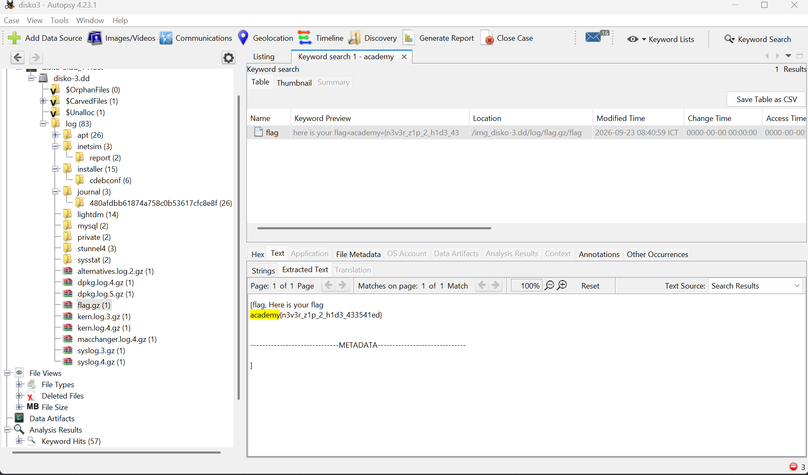

Answer: **academy{n3v3r_z1p_2_h1d3_433541ed}**

## 3. DISKO 4
Link bài: https://learn.cylabacademy.org/library/704?page=1&difficulty=2&category=4

Cách em làm:
* Em vào autospy thấy folder log có file dont-delete thì có flag

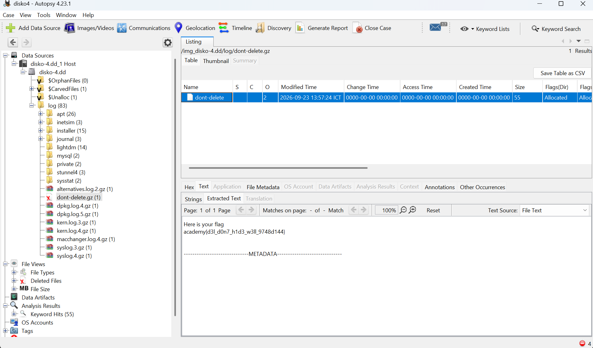

Answer: **academy{d3l_d0n7_h1d3_w3ll_9748d144}**

## 4. Forensics Git 0
Link bài: https://learn.cylabacademy.org/library/705?page=1&difficulty=2&category=4

Cách em làm:
* Em vào folder home thì thấy có folder ctf nên vào xem mò và ra flag

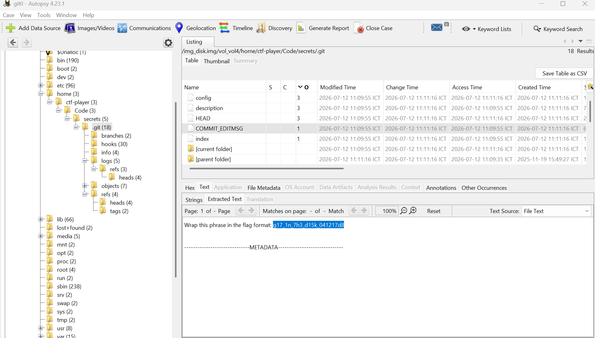


Answer: **academy{g17_1n_7h3_d15k_041217d8}**

## 5. Forensics Git 1
Link bài: https://learn.cylabacademy.org/library?page=1&difficulty=2&category=4

Cách em làm: 
* Em vào thì thấy

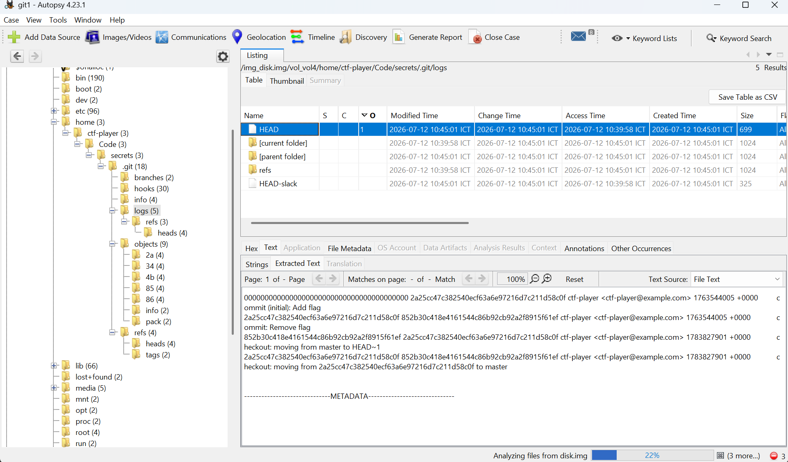

* Nếu vậy chỉ cần khôi phục lại file flag và đọc thôi
* Em dùng hint coi thử xem có tool nào không và biết được lệnh để khôi phục file bị xóa
```bash
git checkout <hash>
```

```bash
PS C:\Users\ASUS\Downloads\secrets> git checkout 2a25cc47c382540ecf63a6e97216d7c211d58c0f
Note: switching to '2a25cc47c382540ecf63a6e97216d7c211d58c0f'.

You are in 'detached HEAD' state. You can look around, make experimental
changes and commit them, and you can discard any commits you make in this
state without impacting any branches by switching back to a branch.

If you want to create a new branch to retain commits you create, you may
do so (now or later) by using -c with the switch command. Example:

  git switch -c <new-branch-name>

Or undo this operation with:

  git switch -

Turn off this advice by setting config variable advice.detachedHead to false

HEAD is now at 2a25cc4 Add flag
PS C:\Users\ASUS\Downloads\secrets> ls


    Directory: C:\Users\ASUS\Downloads\secrets


Mode                 LastWriteTime         Length Name
----                 -------------         ------ ----
d-----        11/11/2026   8:45 AM                .git
-a----        11/11/2026   8:45 AM             31 flag.txt


PS C:\Users\ASUS\Downloads\secrets> cat .\flag.txt
academy{g17_r3m3mb3r5_d4ddf904}
```

Answer: **academy{g17_r3m3mb3r5_d4ddf904}**

## 6. Forensics Git 2
Link bài: https://learn.cylabacademy.org/library/707?page=1&difficulty=2&category=4

Cách em làm:
* Em vào đọc folder logs thì thấy thiếu 1 file `.txt` 3 nên em nghĩ nó đã bị xóa và dùng checkout tiếp

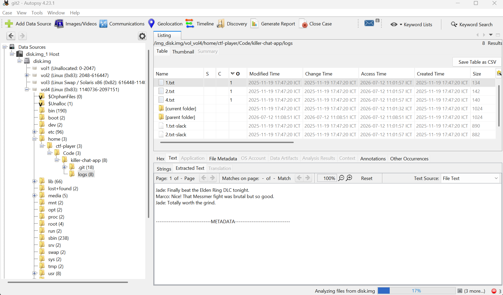

* Em vào tiếp folder .git thì thấy càng củng cố thêm phần suy luận của em là đúng

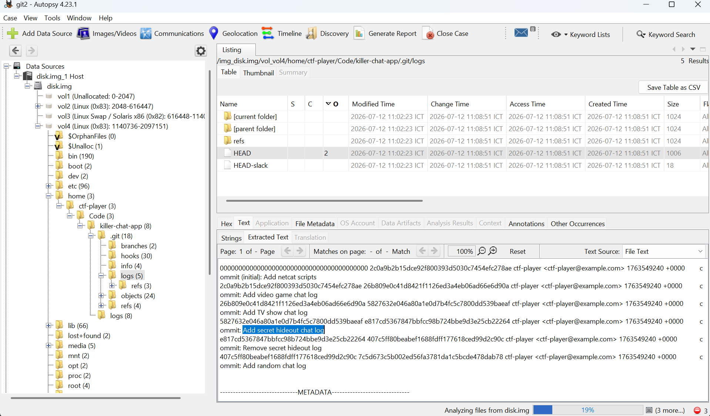

```bash
PS C:\Users\ASUS\Downloads\killer-chat-app> git checkout e817cd5367847bbfcc98b724bbe9d3e25cb22264
M       client
A       logs/4.txt
M       server
Note: switching to 'e817cd5367847bbfcc98b724bbe9d3e25cb22264'.

You are in 'detached HEAD' state. You can look around, make experimental
changes and commit them, and you can discard any commits you make in this
state without impacting any branches by switching back to a branch.

If you want to create a new branch to retain commits you create, you may
do so (now or later) by using -c with the switch command. Example:

  git switch -c <new-branch-name>

Or undo this operation with:

  git switch -

Turn off this advice by setting config variable advice.detachedHead to false

HEAD is now at e817cd5 Add secret hideout chat log
PS C:\Users\ASUS\Downloads\killer-chat-app> ls


    Directory: C:\Users\ASUS\Downloads\killer-chat-app


Mode                 LastWriteTime         Length Name
----                 -------------         ------ ----
d-----        11/11/2026   8:57 AM                .git
d-----        11/11/2026   8:57 AM                logs
-a----        11/11/2026   8:55 AM             25 client
-a----        11/11/2026   8:55 AM            999 client-slack
-a----        11/11/2026   8:55 AM             25 server
-a----        11/11/2026   8:55 AM            999 server-slack


PS C:\Users\ASUS\Downloads\killer-chat-app> cd .\logs\
PS C:\Users\ASUS\Downloads\killer-chat-app\logs> ls


    Directory: C:\Users\ASUS\Downloads\killer-chat-app\logs


Mode                 LastWriteTime         Length Name
----                 -------------         ------ ----
-a----        11/11/2026   8:55 AM            134 1.txt
-a----        11/11/2026   8:55 AM            890 1.txt-slack
-a----        11/11/2026   8:55 AM            142 2.txt
-a----        11/11/2026   8:55 AM            882 2.txt-slack
-a----        11/11/2026   8:57 AM            191 3.txt
-a----        11/11/2026   8:55 AM            140 4.txt
-a----        11/11/2026   8:55 AM            884 4.txt-slack


PS C:\Users\ASUS\Downloads\killer-chat-app\logs> cat .\3.txt
Rex: Meet at the old arcade basement for the secret hideout.
Jay: Ask Rusty at the door and use password academy{g17_r35cu3_16ac6bf3}.
Rex: Bring the decoder map so we can plan the route.
```

Answer: **academy{g17_r35cu3_16ac6bf3}**

## 7. Rogue Tower
Link bài: https://learn.cylabacademy.org/library/714?page=1&difficulty=2&category=4

Cách em làm:
* Em vô tìm được mã nhưng không dễ dàng dịch được và đề cũng yêu cầu khôi phục nên chắc phải thông qua bước nào đó
* Em vào đọc hint thì thấy cần key IMSI (International Mobile Subscriber Identity:  Mã nhận dạng thuê bao di động quốc tế chứa 15 số)
* Em vào xem stream UPD và TCP thì so cái callid thì tìm được key IMSI 

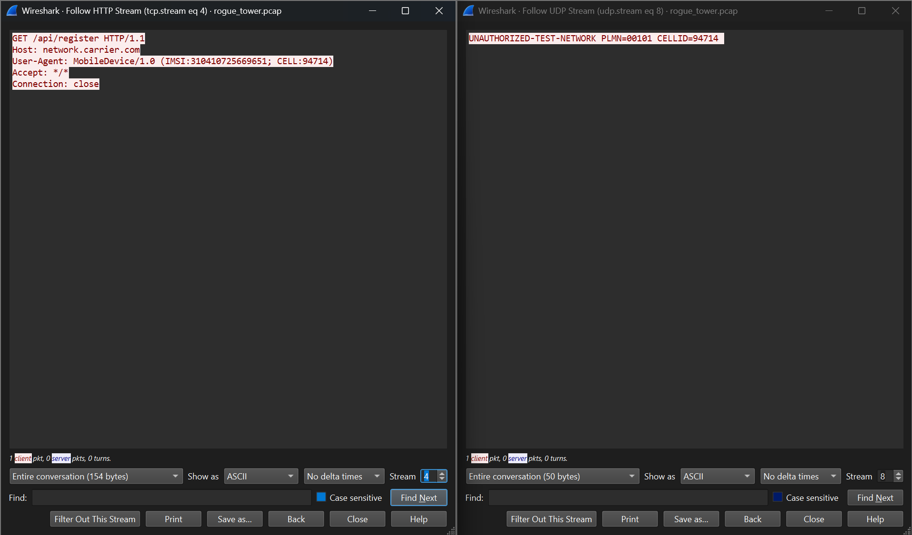

* Tới đây em bí rồi không biết làm gì với key nên em coi write-up người khác thì biết được key đó phải xor với mã 

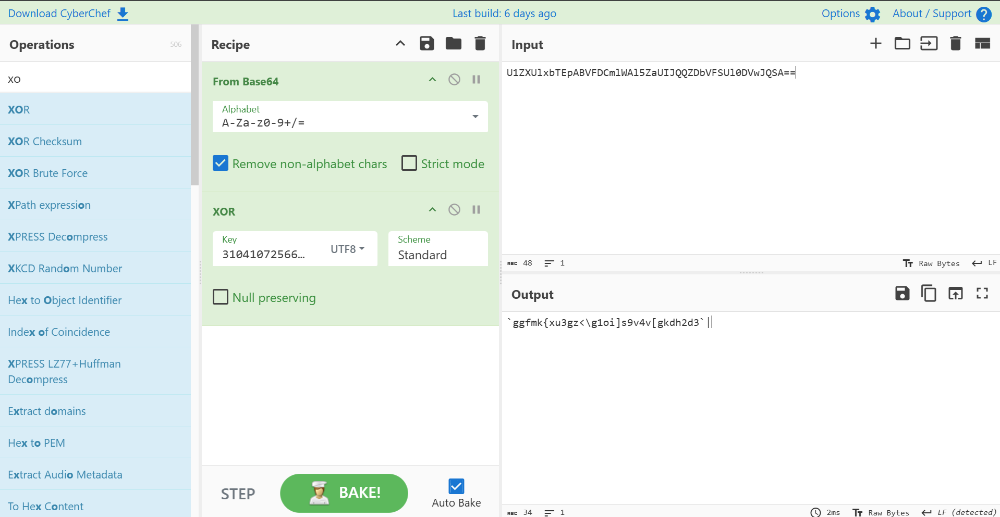

* Nhưng lên dán vậy vẫn chưa ra mã  
* Em thử xor với `academy{` để tìm key thử
thì ra kết quả sau 

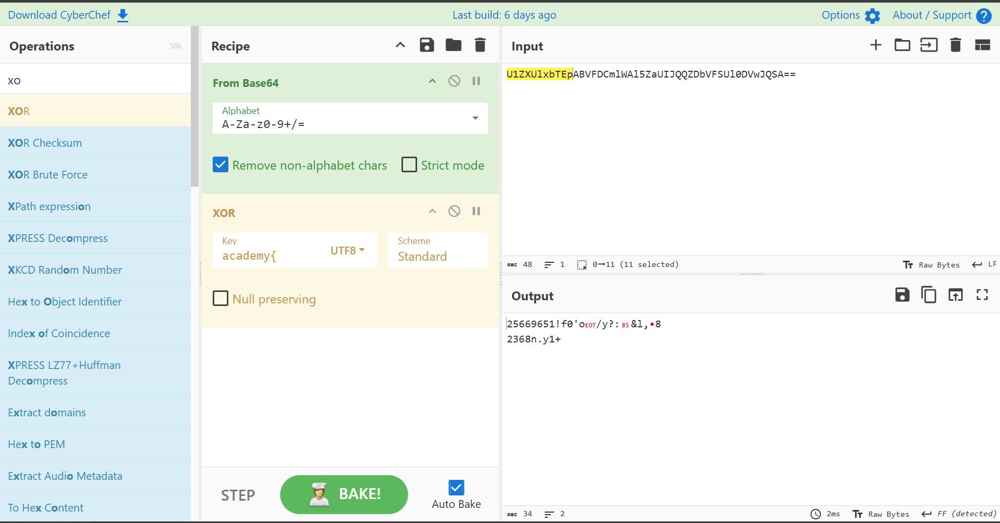

* Số **25669651** là 8 số đuôi của key trên và dùng số đó xor là ra flag

Answer: **academy{r0gu3_c3ll_t0w3r_dddd5b3b}**

## 8. Timeline 0
Link bài: https://learn.cylabacademy.org/library/720?page=1&difficulty=2&category=4

Cách em làm:
* Em thấy tên bài liên quan tới tới timeline nên vào mục timeline autospy thì thấy

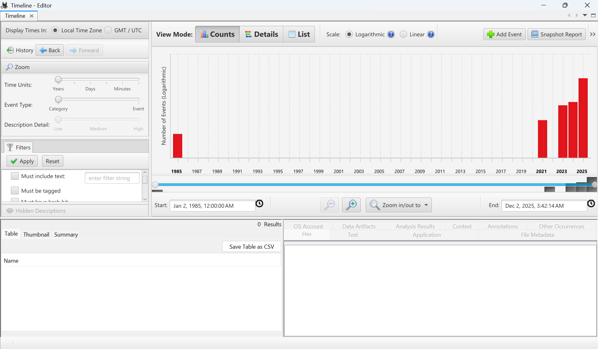

* Vào xem thì thấy mã

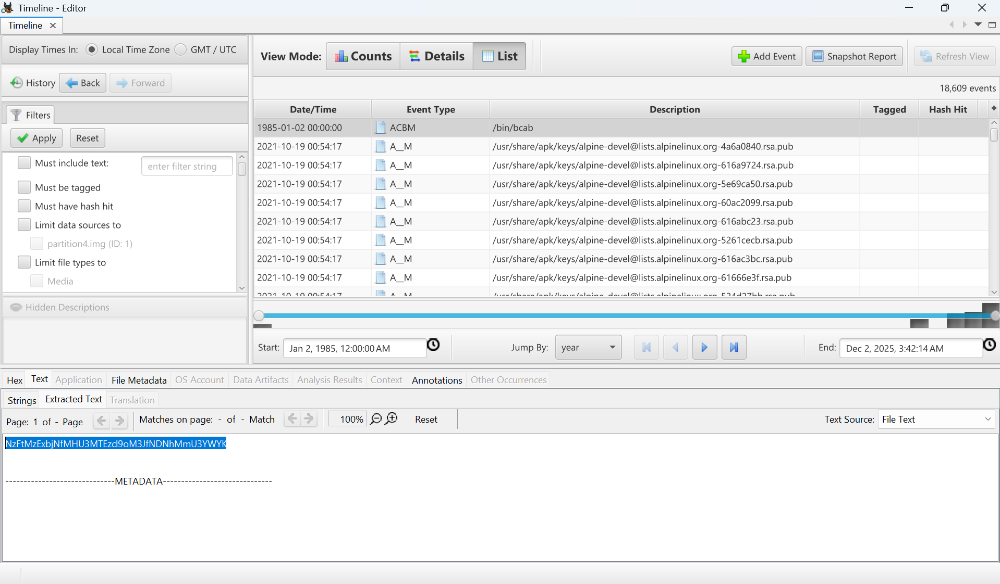

Answer: **academy{71m311n3_0u7113r_h3r_43a2e7af}**

## 9. Timeline 1
Link bài: https://learn.cylabacademy.org/library/721?page=1&difficulty=2&category=4

Cách em làm: 
* Em cũng làm như lần trước nhưng lần này em thấy nó nhiều quá nên không biết mò tới bao giờ nên xem hint cho nhanh
* Dựa vào hint thì em tra được flag

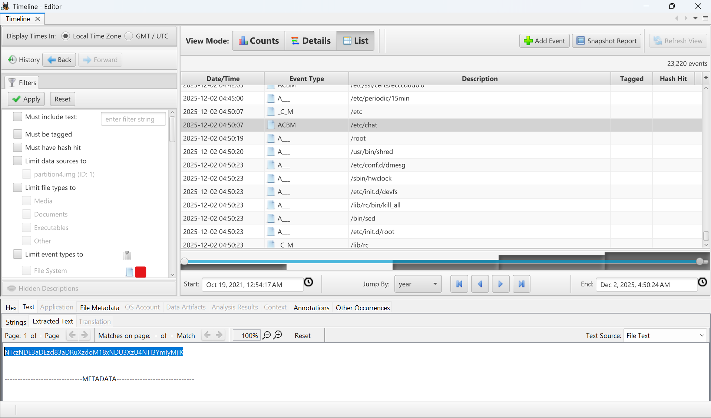

Answer: **academy{573417h13r_7h4n_7h3_1457_58527bb222}**